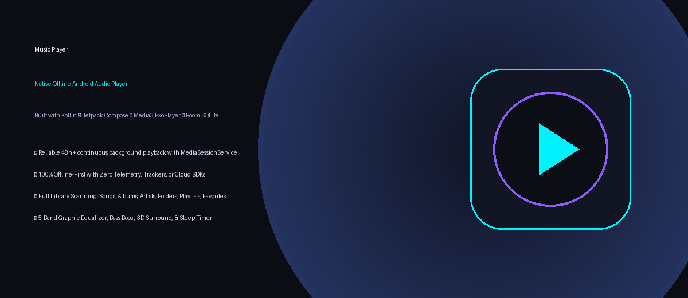
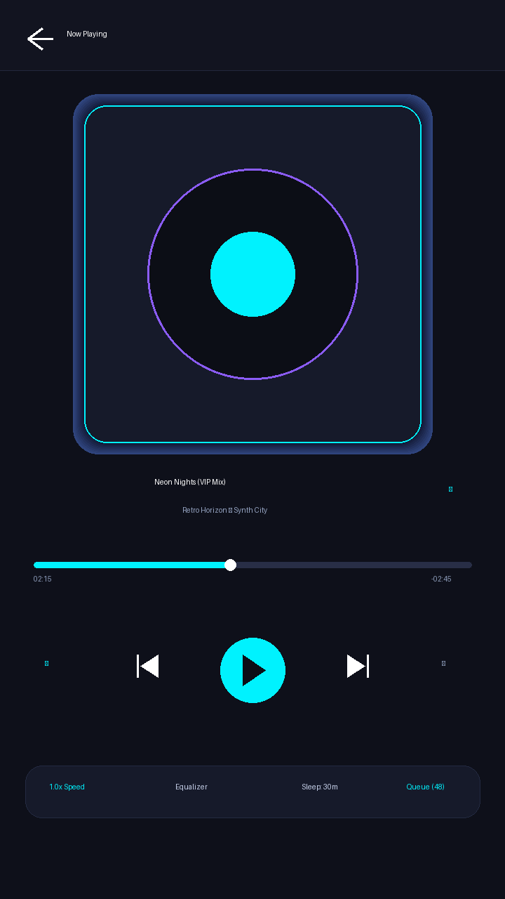
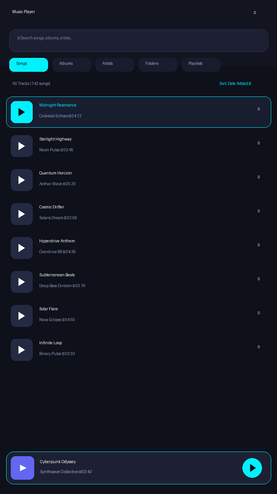
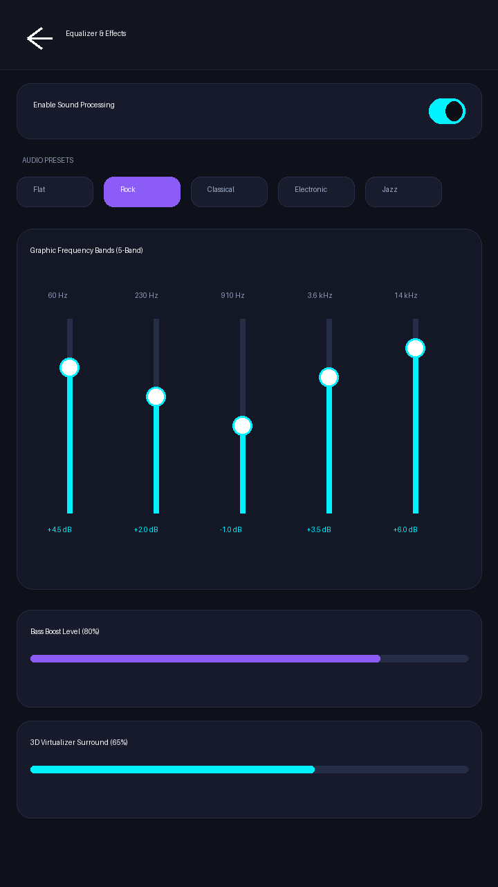

# Music Player

<div align="center">
  
</div>

<p align="center">
  <b>A lightweight, high-performance, offline native Android music player engineered for seamless, uninterrupted background playback.</b>
</p>

<p align="center">
  <a href="releases/MusicPlayer-v1.0.0-release.apk"></a>
  
  
  
  
</p>

---

## 📱 Visual Showcase

<div align="center">
  <table>
    <tr>
      <th width="33%">Now Playing</th>
      <th width="33%">Music Library</th>
      <th width="33%">5-Band Equalizer</th>
    </tr>
    <tr>
      <td></td>
      <td></td>
      <td></td>
    </tr>
    <tr>
      <td align="center"><i>Album Art, Scrubber & Controls</i></td>
      <td align="center"><i>8-Tab Organization & Search</i></td>
      <td align="center"><i>Frequency Bands & Bass Boost</i></td>
    </tr>
  </table>
</div>

---

## ⚡ Highlights & Key Capabilities

- **Uninterrupted Background Playback (48h+ Capable)**: Built on AndroidX `MediaSessionService` and ExoPlayer with `C.WAKE_MODE_LOCAL`. Playback stays smooth whether the screen is locked, the user switches apps, or the Activity is destroyed by the system.
- **Complete Local Media Scanner**: Scans device storage using the Android `MediaStore` content provider. Categorizes tracks into **All Songs**, **Albums**, **Artists**, **Folders**, **Recently Added**, **Recently Played**, **Favorites**, and **Playlists**.
- **Hardware-Accelerated Equalizer**: 5-band frequency equalizer with 9 genre-tuned presets (*Rock, Classical, Dance, Flat, Heavy Metal, Hip Hop, Jazz, Pop, Normal*), Bass Boost, and 3D Virtualizer audio spatialization.
- **Smart Audio Interruption Handling**: Pauses on incoming telephone calls and gracefully resumes. Automatically halts audio on headphone disconnect or Bluetooth uncoupling (`setHandleAudioBecomingNoisy(true)`).
- **Sleep Timer Utility**: Countdown timer presets (15m, 30m, 45m, 60m), custom minute inputs, or automatic stop when the currently playing track finishes.
- **Persistent Playback Queue & Playlists**: Add next, reorder tracks via dragging, clear queues, and manage custom playlists backed by an offline Room SQLite database.
- **Material 3 Design System**: Adaptive Dark and Light themes accompanied by 5 selectable accent color palettes (*Royal Purple, Ocean Blue, Electric Teal, Sunset Orange, Emerald Green*).
- **100% Offline & Private**: Zero cloud dependencies, zero analytics SDKs, zero background telemetry, and zero artificial intelligence models. Audio files and listening history never leave your device.

---

## 🏗 Architecture & Engineering

The application follows the recommended Android Architecture guidelines with separation of concerns:

```
com.musicplayer.app
├── data
│   ├── local          # Room Database, DAOs (Playlists, Favorites, Play History)
│   ├── mediastore     # Async MediaStore queries, metadata extraction, folder grouping
│   └── repository     # Single source of truth: MusicRepository & PreferencesRepository
├── model              # Immutable domain entities (Song, Album, Artist, Playlist, PlaybackState)
├── player             # PlayerConnection (IPC Controller bridge), Equalizer, SleepTimer
├── service            # MusicService (MediaSessionService, AudioFocus, Notification channel)
├── ui
│   ├── components     # Reusable Compose widgets (MiniPlayer, SongItem, AlbumCard, SearchBar)
│   ├── screens        # Full-screen Composable views (MainScreen, NowPlaying, Equalizer, Settings)
│   └── theme          # Dynamic Material 3 typography, color palettes, and themes
├── util               # Modern permission handling (API 33+ READ_MEDIA_AUDIO), time & file formatters
└── viewmodel          # ViewModels managing state flows (Main, Playlist, Equalizer, Settings)
```

---

## 📦 Quick Download & Installation

You can download the pre-compiled, signed APK directly:

📥 **[Download MusicPlayer-v1.0.0-release.apk](releases/MusicPlayer-v1.0.0-release.apk)** (15 MB)

### Installation via ADB
```bash
adb install -r releases/MusicPlayer-v1.0.0-release.apk
```

---

## 🛠 Building From Source

### Prerequisites
- JDK 17 installed and configured (`JAVA_HOME`)
- Android SDK installed (`platforms;android-35`, `build-tools;35.0.0`)
- Visual Studio Code or Android Studio

### Build Commands

```bash
# Clone the repository
git clone https://github.com/sobuj-here/Music-Player.git
cd Music-Player

# Build Debug APK
./gradlew assembleDebug

# Build Signed Release APK
./gradlew assembleRelease
```

Generated APK paths:
- Debug APK: `app/build/outputs/apk/debug/app-debug.apk`
- Release APK: `app/build/outputs/apk/release/app-release.apk`

---

## 🔋 Battery Optimization Guide

To guarantee continuous audio playback on hardware with strict background process killers (Samsung OneUI, Xiaomi HyperOS/MIUI, OnePlus OxygenOS, Huawei EMUI):

1. Go to **Settings > Apps > Music Player > Battery**.
2. Select **Unrestricted** (or turn off *Battery Optimization*).
3. Ensure background activity permissions are kept enabled.

---

## 📄 License

This project is licensed under the MIT License. Developed for clean, offline-first personal music enjoyment.
